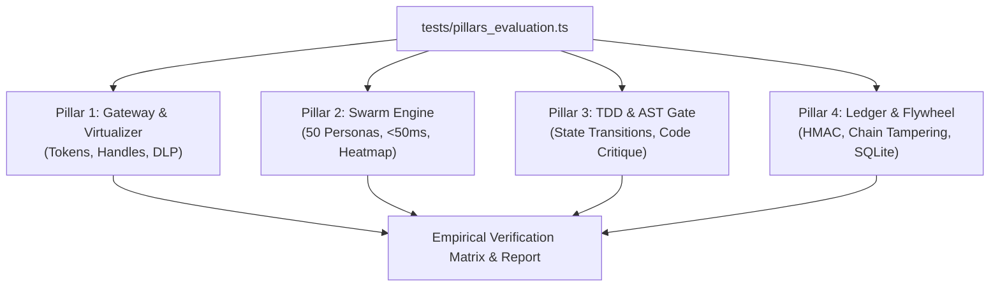

# BlastRadius 2.0 4-Pillar Empirical Verification Plan

> **Goal:** Build and execute an empirical, quantitative test harness to verify whether BlastRadius 2.0 achieves each of its four product pillar claims (Zero-Bloat Gateway, Swarm Pre-Flight Simulator, TDD & AST Quality Gate, Zero-Trust Compliance Ledger).

**Architecture:**
A unified test runner script (`tests/pillars_evaluation.ts`) executes controlled benchmark fixtures against the core engine modules in `blastradius-mcp/src/`. It captures real millisecond latencies, token compression ratios, DLP redactions, state machine transitions, HMAC signatures, and hash-chain tampering detection, outputting structured empirical results.

**Tech Stack:** Node.js (v22+), TypeScript, `@modelcontextprotocol/sdk`, crypto (HMAC-SHA256), node:test / node:sqlite.

---

### Task 1: Create the Comprehensive 4-Pillar Evaluation Script
**Files:**
- Create: `blastradius-mcp/tests/pillars_evaluation.ts`
- Consumes:
  - `src/gateway/semanticRouter.ts`, `src/gateway/contextVirtualizer.ts`
  - `src/swarm/nativeEngine.ts`, `src/swarm/personas/index.ts`, `src/swarm/heatmapGenerator.ts`
  - `src/quality/tddStateMachine.ts`, `src/quality/codeCritique.ts`
  - `src/security/tokenManager.ts`, `src/security/auditLedger.ts`, `src/storage/flywheel.ts`

- [ ] **Step 1:** Implement Pillar 1 test cases: measure token reduction percentage on 50KB payload, verify `ctx_` handle generation, verify DLP masking of AWS keys and DB connection strings.
- [ ] **Step 2:** Implement Pillar 2 test cases: run 50-persona swarm simulation across 10 iterations measuring min/avg/max latency in ms; run targeted reviews for Hacker (SQLi), Data Corruptor (null bytes), and Concurrency Racer; verify heatmap danger scores.
- [ ] **Step 3:** Implement Pillar 3 test cases: verify TDD state machine enforcement (reject premature GREEN; enforce RED failure evidence; unlock write permissions only in GREEN/REFACTOR); run AST critique against empty `catch(e){}` and unsafe sinks.
- [ ] **Step 4:** Implement Pillar 4 test cases: issue HMAC-SHA256 token, verify consumption, verify replay attempt is rejected; verify intact audit ledger, tamper with a record in disk/memory, verify tamper detection; verify local SQLite flywheel pattern indexing.

### Task 2: Compile & Execute the Evaluation Script
**Files:**
- Execute via terminal in `blastradius-mcp`
- [ ] **Step 1:** Compile `tests/pillars_evaluation.ts` using `npm run build` or `npx tsc`.
- [ ] **Step 2:** Execute `node dist/tests/pillars_evaluation.js` and capture raw execution output and timings.

### Task 3: Synthesize Empirical Results & Gap Analysis
**Files:**
- Inspect terminal logs and output metrics.
- [ ] **Step 1:** Validate whether Pillar 1 achieved ~99% token cut (or what exact percentage it achieved).
- [ ] **Step 2:** Validate whether Pillar 2 achieved 50 personas in <50ms.
- [ ] **Step 3:** Validate whether Pillar 3 properly blocked production modification and caught AST anti-patterns.
- [ ] **Step 4:** Validate whether Pillar 4 prevented token replays and detected log tampering.
- [ ] **Step 5:** Present final assessment and use-case recommendations.

