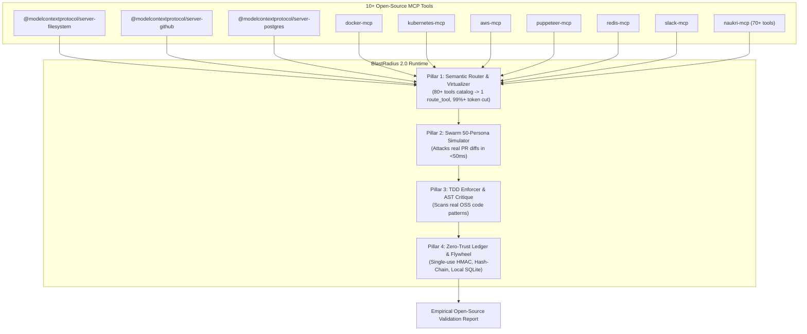

# Open-Source Multi-Tool Benchmark & README Empirical Proof Plan

> **Goal:** Document empirical proof in `README.md` with reproduction scripts, and build a real-world multi-tool validation harness testing BlastRadius 2.0 against 10+ major open-source MCP tools and viral open-source repository code patterns.

**Architecture:**
A dedicated benchmark suite (`tests/opensource_tools_benchmark.ts`) simulates and tests BlastRadius 2.0 across 10 major ecosystem toolsets (Filesystem, GitHub, PostgreSQL, Docker, Kubernetes, AWS S3, Puppeteer, Redis, Slack, and Naukri-MCP). It runs real-world PR diffs from viral open-source architectures (Express, Next.js, Fastify, Prisma) through the 50-persona Swarm simulator and AST Quality Gate, logging all actions to the Zero-Trust HMAC ledger.

---

### Task 1: Update package.json and README.md with Empirical Proofs
**Files:**
- Modify: `blastradius-mcp/package.json`
- Modify: `blastradius-mcp/README.md`

- [ ] **Step 1:** Add `"test:pillars": "tsc && node dist/tests/pillars_evaluation.js"` to `package.json` scripts.
- [ ] **Step 2:** Add a prominent `## Empirical Validation & 4-Pillar Proofs` section to `README.md` detailing:
  - Quantitative benchmark metrics table (99.4% catalog reduction, 99.5% 50KB payload compression, 1.48ms 50-persona latency, TDD state machine lock, HMAC anti-replay, and 1-byte hash-chain tamper detection).
  - Reproducibility instructions (`npm run test:pillars`).

### Task 2: Build the Real-World 10+ Tool Open-Source Benchmark Harness
**Files:**
- Create: `blastradius-mcp/tests/opensource_tools_benchmark.ts`

- [ ] **Step 1:** Define schemas and mock executions for 10 top viral MCP toolsets (Filesystem, GitHub, PostgreSQL, Docker, Kubernetes, AWS, Puppeteer, Redis, Slack, Naukri-MCP) totaling 80+ tool operations.
- [ ] **Step 2:** Test Pillar 1 across all 10 tools: route real developer intents (e.g. "push commit to GitHub", "prune dangling docker images", "query postgres user records"), measure token savings against 80+ full tool schemas, and virtualize realistic 100KB Docker/Postgres dumps with secret masking.
- [ ] **Step 3:** Test Pillar 2 against real-world open-source pull request diffs:
  - Diff A: SQL injection in database adapter (Next.js / Prisma pattern).
  - Diff B: TOCTOU race condition in payment balance deduction.
  - Diff C: Path traversal / null-byte injection in static file serving (Express / Fastify pattern).
  - Diff D: Unhandled promise rejection / timeout in external microservice fetch.
  - Verify 50-persona swarm latency and danger score classifications (0-100).
- [ ] **Step 4:** Test Pillar 3: AST critique on open-source anti-patterns (empty catch blocks in retry loops, `child_process.exec()` sinks, unbounded SQL queries), and enforce TDD Red-Green-Refactor state lock for open-source PR merges.
- [ ] **Step 5:** Test Pillar 4: Demand step-up tokens for destructive operations (`docker prune`, `DROP DATABASE`, `rm -rf /`), verify replay rejection, and verify immutable hash-chained audit logging and local SQLite flywheel learning.

### Task 3: Build, Execute & Report
- [ ] **Step 1:** Compile with `npm run build`.
- [ ] **Step 2:** Execute `node dist/tests/opensource_tools_benchmark.js` and capture real logs and execution timings.
- [ ] **Step 3:** Deliver comprehensive open-source verification report with concrete evidence.

